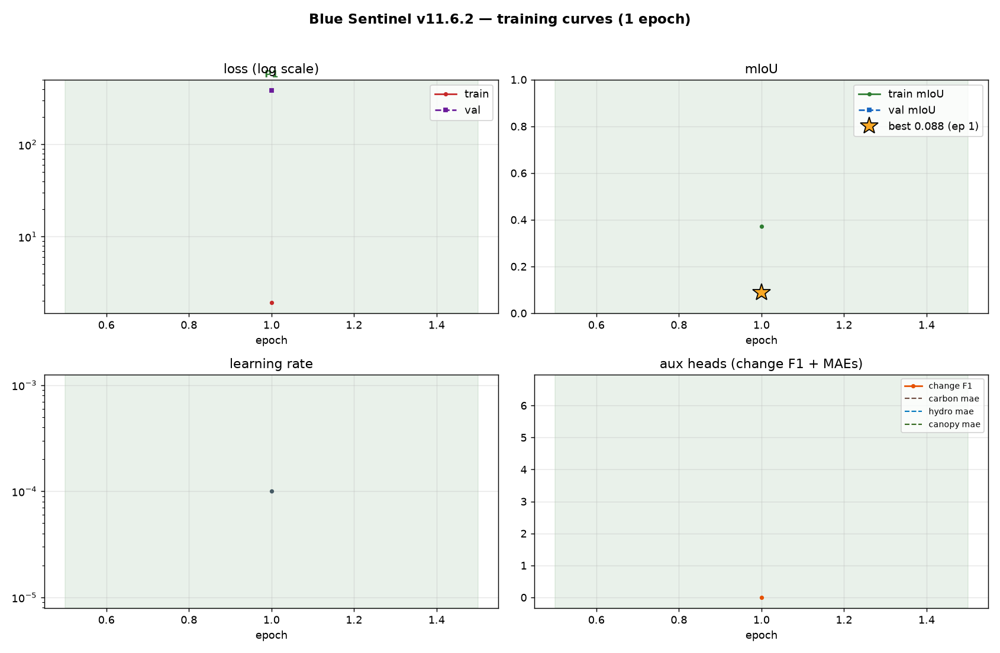
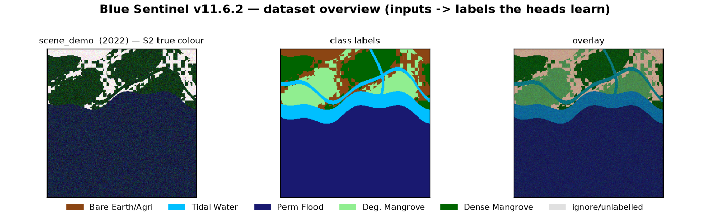

# 🌱 Blue Sentinel — Mangrove Ecosystem Monitor

> A unified **spatio-temporal State Space Model (Mamba / SS2D)** that turns multi-sensor
> satellite cubes into **14 mangrove-monitoring products** — land cover, degradation,
> recovery, change *year*, carbon stocks, canopy height, water depth and risk — packaged
> as an end-to-end **MRV** (Monitoring, Reporting, Verification) pipeline for blue-carbon
> accounting. Single-file, Kaggle-ready, self-healing.


---

## What it does

Blue Sentinel ingests a **25-channel cube sampled at T temporal steps** (Sentinel-2 optical,
Sentinel-1 SAR, ALOS PALSAR-2 L-band, CHIRPS precipitation, tide-model inundation and terrain
auxiliaries) and jointly predicts **14 products** through a 3-phase curriculum with learned
uncertainty task-weighting:

| Head | Output | Trained from |
|------|--------|--------------|
| `seg` (+ deep supervision) | 5-class land cover: bare/agri · tidal water · perm. flood · degraded mangrove · dense mangrove | `label` |
| `species` | 3-class species composition | `species` labels |
| `change` / `change_year` | deforestation alert + year of change (split-conformal threshold) | `change` / `change_year` |
| `recovery` / `damage` | restoration & debris probability | `recovery` / `debris` |
| `carbon` | AGB (t/ha) with heteroscedastic σ | `carbon` |
| `canopy` | canopy height (m, GEDI-scale) | `gedi` |
| `hydro` | water depth μ/σ (tidal) | `depth` / inundation prior |
| `eco` | LST + moisture | `eco` |
| `risk` | composite risk index | `risk` |
| `quality` / `boundary` | pixel usability / class edges | free supervision (SCL, label edges) |

Heads whose labels are absent **auto-disable** at startup and re-enable when labels are wired.

## Architecture

```
 cube (B,T,25,256,256)
   ├── opt_stem (S2, 11ch) ─┐
   ├── radar_stem (S1, 6ch) ─┼→ fuse → 4-stage VSS encoder (SS2D scans)
   └── aux_stem (env, 8ch) ─┘        │  6-direction selective scan per block:
                                     │    → right, ← left, ↓ down, ↑ up,
                                     │    → time-forward, ← time-backward
                                     ├── skips → 3× decoder (VSS) ──→ 11 RGB-scale heads
                                     └── |last-first| diffs → FiLM(time) change decoder → 4 change heads
```

- **Selective scan**: `mamba_ssm` CUDA kernels when available, with a verified
  **chunked Hillis-Steele pure-PyTorch fallback** (~60× fewer kernel launches than a
  naive loop — values *and* gradients unit-tested against the recurrence).
- **Gradient checkpointing** on every VSS block (T4-16GB safe), fp16 autocast on Turing,
  bf16 on Ampere+ (gated on compute capability — torch ≥2.7 falsely reports bf16 on sm_75).
- **Pure-PyTorch fallbacks everywhere**: no hard dependency on CUDA-only packages.

## Quickstart (Kaggle — T4 ×2, the target environment)

```python
# Cell 1: paste blue_sentinel_v11_kaggle.py (defines everything, runs nothing)
# Cell 2:
main("smoke")                    # 2-5 min self-test: 9 subsystem checks
main(["train", "--resume"])      # 12-epoch compressed curriculum (see below)
main(["eval", "--test-dir", "/kaggle/working/data/test"])
main(["export", "scene_dir", "ref.tif", "/kaggle/working/out"])   # full MRV products
```

The startup banner auto-configures the GPU plan (16 GB cards: single-GPU batch=2,
grad_accum=2 → effective batch 4; ≥24 GB: DataParallel), auto-installs the mamba-ssm
CUDA wheel when missing, and resumes from `last_v11.pt` when present.

## Quickstart (local)

```bash
pip install torch numpy matplotlib   # mamba-ssm optional (CUDA scan)
python blue_sentinel_v11_kaggle.py smoke
python blue_sentinel_v11_kaggle.py train --train-dir data/train --val-dir data/val
```

## Data schema

Scene folders of dated step NPZs (`train/scene_x/step_YYYY.npz`, last step carries labels)
or a single cube NPZ — auto-detected. Raw GEE GeoTIFF exports (`{aoi}_{year}.tif` +
`{aoi}_static.tif`) are packed into v11 scenes by `main(["build"])`. ZIP datasets are
extracted and split dirs auto-located. See `gee_dataset_builder_v11.py` (Part A) to build
the exports from Google Earth Engine.

## What a run produces (`/kaggle/working/`)

| Artifact | What |
|----------|------|
| `best_v11.pt` / `last_v11.pt` | best-val / per-epoch checkpoints (+ mid-epoch resume points every 100 steps) |
| `training_log.csv` | epoch, phase, LR, losses, mIoU, F1, MAEs |
| `training_curves.png` | auto-regenerated loss/mIoU/LR/aux curves (below) |
| `dataset_overview.png` | what the model sees: S2 true colour, label maps, overlays (below) |
| `config_v11.json`, `confusion_test.csv`, `metrics.json` | reproducibility + eval |
| `final_calibrated_v11.pt` | temperature- + conformal-calibrated final model |
| `out/` (export mode) | GeoTIFF products, change-alert GeoJSON, STAC item, MRV carbon summary, dashboard HTML |

## Training curves (auto-generated every epoch)



## Dataset overview — inputs → labels (synthetic demo tile)



## Reliability engineering

Built for unattended 12-hour Kaggle sessions on shared T4s. Failure modes found and fixed
across v11.x, each guarded by regression checks in `smoke`:

- **Host-RAM leak** (~72 MB/batch, linear → OOM): the CUDA driver pins *fresh* page ranges
  used as H2D copy sources; fixed with a persistent pinned staging buffer reused every batch
- **DataParallel two-replica leak**: batch=2 through `nn.DataParallel` leaks host RAM on
  torch 2.11/cu128 — single-GPU batch=2 is the default (same throughput, no leak)
- **bf16 on Turing**: torch ≥2.7 reports bf16 "supported" on sm_75 via emulation flags but
  cuDNN has no bf16 conv kernels → "FIND was unable to find an engine" crash; AMP is gated
  on compute capability ≥ 8.0
- **Mamba CUDA kernels missing** after session restarts: auto-installs the matching
  prebuilt wheel (cu12.8/torch-matched) with a vectorized pure-torch scan as fallback
- **Heartbeat telemetry**: per-10-step loss + host RSS (shared/private split) + GPU memory,
  plus per-scene loader mode/RSS lines
- **OOM ladder**: batch → mirror → grad-accum auto-halving with epoch retry; mid-epoch
  checkpoints every 100 optimizer steps; early stopping armed only after the EMA warmup

## Limitations (honest)

- Prototype dataset: 5 training scenes / 2 val — `species`, `damage` and `risk` heads
  auto-disable until their labels are wired
- No published baseline comparison (U-Net ablation pending)
- 256 px × T=5 on a T4 is ~5 h/epoch — the architecture is happier on A100-class hardware
- Carbon estimates inherit GEDI/GEE label quality; credit-grade MRV needs plot calibration

## Repository layout

```
blue_sentinel_v11_kaggle.py   ← the system (single file, Kaggle edition)
gee_dataset_builder_v11.py    ← GEE Part-A export builder (Drive → GeoTIFFs)
blue-sentinel-v11.py          ← non-Kaggle edition (workstation)
blue-sentinel-v9.py, mangrove-*.py ← legacy v3-v9 lineage
assets/                       ← training curves + dataset overview (regenerated each run)
output_v11/                   ← run artifacts (gitignored; checkpoints ~200 MB each)
```

## Roadmap

- [ ] Wire species/damage/risk labels → re-enable the disabled heads
- [ ] U-Net + SegFormer baselines & ablations (scan directions, T, patch size)
- [ ] More AOIs (10+ scenes across biogeographic regions)
- [ ] torch.compile / DDP for multi-GPU throughput
- [ ] Credit-grade carbon validation against field plots

## License

MIT — see [LICENSE](LICENSE).
